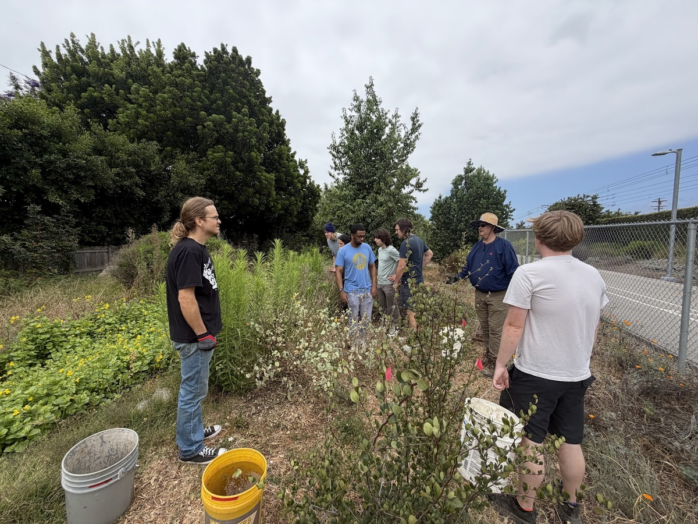
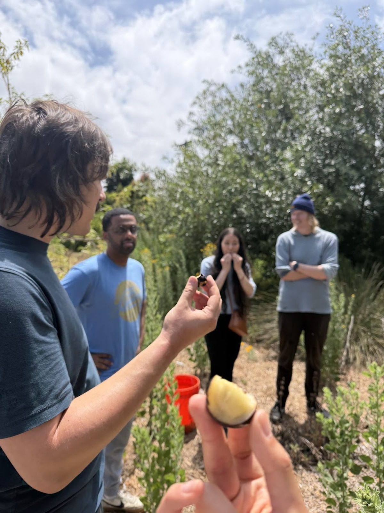
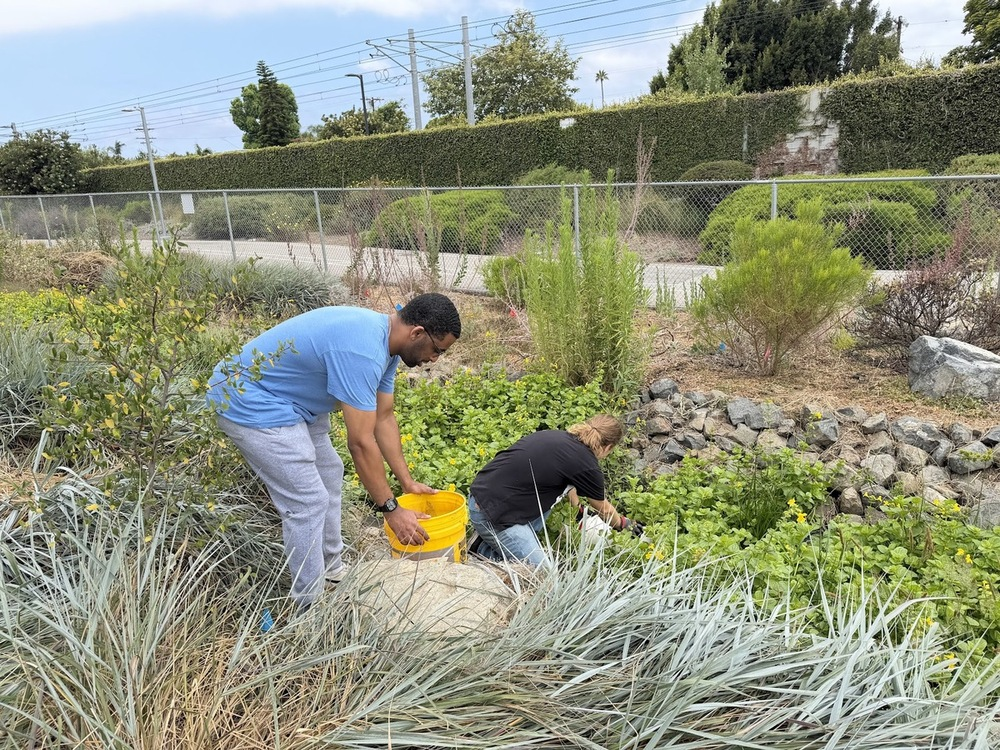
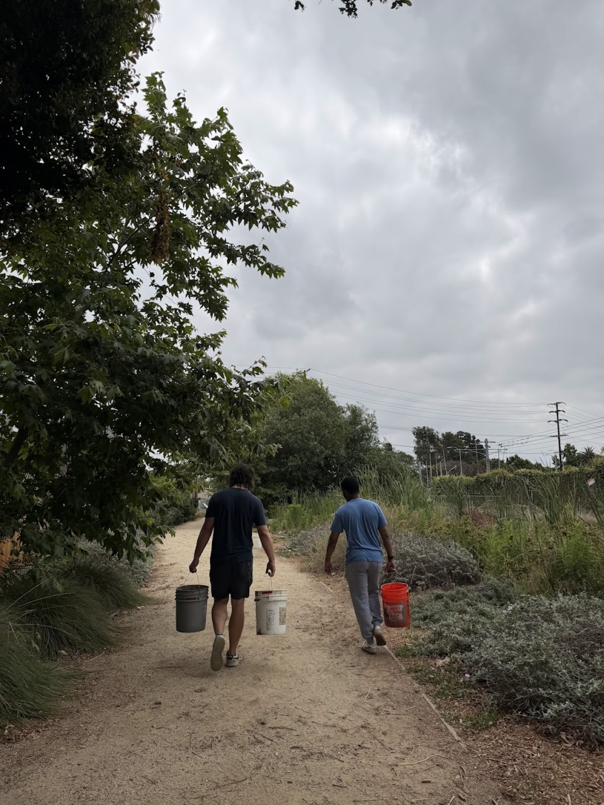

 
A few of us made it out to the Westwood Greenway recently. If you haven't heard of it, it's a two-acre native plant habitat running alongside the Metro E Line in West LA, right next to the Westwood/Rancho Park station. There's a small stream running through it that filters urban runoff, walking paths, and a surprising amount of wildlife for something sandwiched between a light rail line and a neighborhood.
 
We went to help out with their volunteer watering team, which is exactly what it sounds like. Not glamorous work, but the kind of thing that actually keeps a place like this alive.
 
**Charles**
 
We were met by Charles, the Greenway's president. He's been doing ecological work in LA for decades and it shows. He walked us around before we got started and basically gave us an informal crash course in Southern California ecology. We were asking questions and Charles had an answer for every question.
 
**Native plants and invasives**

 
A big chunk of what we talked about was the invasive plant problem, which is a constant battle at the Greenway. The native species they're growing, things like refugio manzanita, western redbud, and coyote brush, have to compete with introduced species that are often faster growing and harder to get rid of.

We also had a chance to sample some of the edible native plants! 

 
It was great to get everyone outside and a bit more hands on with the local ecology, but we're a tech group, we spend a lot of our time thinking about hardware and software. But hearing Charles talk about it, it's not that different from the kind of maintenance problems we deal with in our own projects. We talk a lot about how you can't just build something and walk away, you have to keep showing up. It's a good lesson in changing paradigms in terms of how we approach developing solutions for folks. Namely that it's best not to build things in the corporate mechanical sense, but to treat it like gardening. Less "move fast and break things" and more "move slow and fix things".
 
**The bees!**

 
The thing that genuinely surprised us was the native bees. Charles pointed out two species that have established a population at the Greenway, which apparently is pretty rare. Native bees need very specific habitat conditions and don't adapt to urban environments the way honeybees do, so having them show up and stick around is a sign the restoration is actually working. We would have walked right past them without knowing what we were looking at. The best part is that one species, globe mallow bees, oftentimes sleep inside of flowers which was pretty dang adorable.
 
**Why we went**
 
We've been trying to get out more. A lot of what CRASH does happens at workbenches and on laptops, and that's great! But it's easy to lose the thread of why we're doing any of it. Spending a morning at a place like the Westwood Greenway, getting a little dirty and talking to someone who really knows the land, gave us a lot of perspective.
 
We're also just interested in what a longer-term relationship with the Greenway might look like. They're a small volunteer organization doing real work with not a lot of resources, which is exactly the kind of group we want to support. Nothing concrete yet, but we'll be going back.
 
If you want to check it out yourself, it's easy to get to on the E Line. More info at [westwoodgreenway.org](https://westwoodgreenway.org).
 

